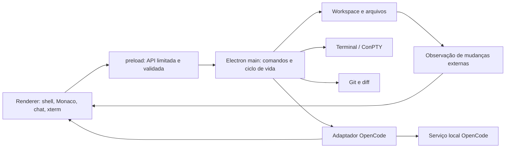

# Esqueleto de evolução da Nuclear Command IDE

Levantamento em 16/10/2026. Base do repositório original: `dbc2e5d`. A segurança da API local e as mensagens de erro do OpenCode estão propostas separadamente na [PR #1](https://github.com/bernardosdbc/nuclear-comand/pull/1), ainda em rascunho. Este documento descreve o produto desejado e a ordem de implementação; não declara as etapas futuras como prontas.

## Objetivo do produto

Uma IDE desktop para Windows, centrada em arquivos de um projeto e no agente GESTOR. O usuário deve conseguir abrir uma pasta, editar e salvar código, executar comandos numa sessão de terminal persistente, pedir alterações ao agente, revisar o diff e aceitar ou rejeitar o resultado. O painel de drones permanece como visão de trabalho, alimentada por eventos reais.

**Decisão de base:** manter Electron e a identidade visual do projeto. Usar Monaco para edição e estudar as separações do workbench do Code - OSS. Não partir de um fork completo do VS Code agora: a compatibilidade com extensões exigiria o workbench e o extension host, enquanto Monaco sozinho não carrega extensões do VS Code. A necessidade de extensões será reavaliada depois do primeiro editor funcional. Fontes: [organização do Code - OSS](https://github.com/microsoft/vscode/wiki/Source-Code-Organization), [FAQ do Monaco](https://github.com/microsoft/monaco-editor/blob/main/README.md).

## O que foi observado

“Verificado” significa teste executado nesta máquina ou por teste automatizado existente. “Parcial” indica funções presentes com limites ou sem teste ponta a ponta. “Pendente” significa que ainda não existe uma função de IDE equivalente. Os testes HTTP desta seção foram executados na branch `feat/local-api-safety`; `main` do repositório original ainda não inclui a PR #1.

| Área | Estado | Evidência e limite |
|---|---|---|
| Janela Electron e painel HTTP | Verificado | `npm.cmd start` abriu o app; `GET /` respondeu 200. O servidor da PR #1 escuta em `127.0.0.1`. |
| Estado, registro, ordens e drones | Parcial | `GET /api/estado` respondeu. A tela lê arquivos versionados a cada 3 s; `jogo/estado.json` contém um snapshot, não telemetria da execução atual. “AO VIVO” não deve ser usado como prova de atividade real. |
| Conexão com OpenCode | Verificado com limite | `/api/chat/status` informou sessão conectada. O modelo padrão `Big Pickle` devolveu 429 por limite de uso numa tentativa real de prompt; isso é uma condição do provedor. |
| Lista e troca de modelos | Parcial | `/api/modelos` respondeu com uma lista de modelos; a presença na lista não prova autorização ou cota. A troca por `/api/modelo` existe no código, mas não foi revalidada nesta auditoria. |
| Terminal | Parcial | `POST /api/ps` executou `Get-Location` e retornou código 0. Cada comando cria um novo PowerShell; diretório, variáveis e processos interativos não persistem. |
| Arquivos e editor | Pendente | Não há pasta de trabalho selecionável, árvore de arquivos, editor, salvar, arquivos sujos ou comparação de alterações. |
| Busca e Git | Pendente | Não há UI de busca no projeto, status Git ou diff. |
| Sessões e aplicação de mudanças do agente | Pendente | O chat cria uma sessão por inicialização; não há retomada, cancelamento, associação a arquivos abertos ou revisão das mudanças. |
| UI e animações | Parcial | Abas, sidebar, painel inferior redimensionável, toasts e pulsos existem em `jogo/interface.html`. Não há shell de editor, estados vazios consistentes nem teste visual de acessibilidade. A página é um único arquivo de cerca de mil linhas. |

Versões observadas: Electron `33.4.11`, `@opencode/client` `2.0.26`, serviço OpenCode `2.0.30`. A documentação pública atual do OpenCode mostra `@opencode-ai/sdk`, diferente do pacote instalado. Toda migração de SDK precisa de um adaptador e teste de contrato antes de trocar chamadas em produção. Fontes: [SDK do OpenCode](https://docs.opencode.ai/docs/sdk/), [servidor e OpenAPI](https://docs.opencode.ai/docs/server/).

## Tela alvo

```text
┌──────────────────────── projeto · comando rápido · modelo · conexão ────────────────────────┐
│ barra de │ Explorer / Busca / Git / Tarefas │ abas e editor de código │ GESTOR / drones    │
│ atividade│ árvore da pasta ativa            │ Monaco + diff lado a lado│ sessão e atividade │
│          │                                  │                         │                    │
├──────────┴──────────────────────────────────┴─────────────────────────┴────────────────────┤
│ painel inferior: Terminal | Saída | Problemas | Log do agente                              │
├─────────────────────────────────────────────────────────────────────────────────────────────┤
│ branch · arquivo · linguagem · posição · estado de salvamento · OpenCode                    │
└─────────────────────────────────────────────────────────────────────────────────────────────┘
```

O editor e os arquivos passam a ser o centro. O chat ocupa uma lateral recolhível; a visão de drones mostra tarefas reais, não substitui o Explorer. A estrutura segue o padrão de Activity Bar, sidebar, editor, painel e status bar descrito pela [UI do VS Code](https://code.visualstudio.com/docs/editing/getting-started/userinterface), mas mantém a aparência Nuclear Command.

### Linguagem visual e movimento

- Criar tokens de cor, tipografia, espaçamento, raio, duração e foco. Usar a mesma semântica de cor para conexão, erro, alteração pendente e sucesso em todas as telas.
- Começar com `120 ms` para hover/foco, `180 ms` para menus e abas e até `240 ms` para abrir painéis; ajustar após teste no Electron. Usar uma curva de desaceleração consistente. Estes são alvos de design, não medições do app atual.
- Aplicar feedback curto a hover, seleção de aba, abertura de menus e toasts. Animar prioritariamente `opacity` e `transform`; redimensionamento arrastado deve acompanhar o cursor sem animação retardada.
- Reservar animação contínua para uma operação em andamento. O indicador “AO VIVO” só pulsa quando houver conexão e atividade verificável; os drones só animam durante uma tarefa real.
- Respeitar `prefers-reduced-motion`, foco visível, navegação por teclado, contraste e rótulos acessíveis. Testar telas vazias, erro, carregamento, sucesso e reconexão. Referências: [UX Guidelines do VS Code](https://code.visualstudio.com/api/ux-guidelines/overview) e [orientações de UI do VS Code](https://code.visualstudio.com/docs/editing/getting-started/userinterface).
- Preservar larguras dos painéis, aba ativa, arquivos abertos e posição do terminal entre reinícios. O status bar deve refletir o arquivo e a sessão atuais, não apenas um snapshot.

## Limites entre módulos



O renderer não recebe acesso direto a `fs`, `child_process` ou ao SDK do OpenCode. O processo principal valida argumentos, pasta ativa e remetente de cada operação privilegiada. O preload expõe funções específicas, por exemplo `workspace.open`, `files.read`, `files.save`, `terminal.create`, `terminal.write`, `agent.send` e `agent.cancel`; ele não expõe `ipcRenderer` genérico. Isso segue as recomendações de [isolamento, IPC e validação do Electron](https://www.electronjs.org/docs/latest/tutorial/security/). A API HTTP atual pode continuar durante a migração, mas cada rota deve ter responsável claro e contrato de entrada e saída.

Estrutura proposta, criada aos poucos conforme cada fatia ficar funcional:

```text
app/
  main.js                    # bootstrap Electron; encolher ao longo da migração
  preload.js                 # ponte de funções permitidas ao renderer
  services/
    workspace.js             # pasta ativa, caminhos e preferências
    files.js                 # leitura, gravação, conflitos e observação
    opencode-adapter.js      # Service.ensure, sessões, eventos, modelos e erros
    terminal.js              # sessões PTY e ciclo de vida
    git.js                   # status e diff da pasta ativa
  ipc/                       # validação de argumentos e handlers por domínio
ui/
  src/
    shell/                   # layout, comandos, atalhos e estado da janela
    explorer/                # árvore, busca rápida e estados vazios
    editor/                  # modelos Monaco, abas, salvar e diff
    agent/                   # chat, passos, permissões e revisão
    terminal/                # xterm e painéis
    styles/                  # tokens, componentes e redução de movimento
jogo/                       # painel legado e estado; migrar sem apagar histórico
docs/
```

### Contratos que devem nascer antes da UI correspondente

1. **Workspace:** uma pasta raiz explícita. Operações de arquivo recebem caminhos relativos à raiz; canonizar o caminho, tratar links simbólicos e impedir saída involuntária da pasta. Guardar o último workspace aberto.
2. **Documento:** `path`, `encoding`, `content`, `version` e `mtime`. `save` deve detectar arquivo alterado externamente, pedir escolha ao usuário e gravar sem truncar dados em caso de falha. Estado `dirty` pertence ao documento, não à aba.
3. **Terminal:** `create/write/resize/close` por `terminalId`; stream de saída, diretório atual e código de saída. Separar terminal interativo de execução de tarefa automatizada.
4. **Agente:** `sessionId`, `workspaceId`, modelo e estado `connecting/idle/running/error`; eventos normalizados (`text`, `tool`, `permission`, `completed`, `failed`). O adaptador converte as diferenças de versão do SDK. Mostrar cota e autenticação como erros distintos de queda do serviço.
5. **Mudanças do agente:** detectar modificações e exibir diff. Para oferecer “aceitar/rejeitar” de verdade, a tarefa precisa executar em área isolada (worktree Git quando possível; alternativa com cópia controlada para projetos sem Git) e só então aplicar o resultado escolhido. Enquanto o agente editar diretamente no workspace, a UI deve dizer “alterações já aplicadas” e oferecer revisão, sem simular aprovação prévia.

## Entregas na ordem recomendada

Cada etapa deve caber em PRs pequenos. UI e backend da mesma função entram juntos, com estados de erro e critérios de pronto.

| Etapa | Entrega | Critério de pronto |
|---|---|---|
| 0. Base confiável | Incorporar ou adaptar a PR #1, criar comandos únicos de teste e status de saúde do painel/OpenCode; manter `AGENTS.md` e README coerentes com o app. | Instalação limpa abre o app; testes da API passam; UI distingue painel, serviço e provedor indisponíveis. |
| 1. Workspace e Explorer | Escolher pasta, mostrar árvore, abrir texto, criar/renomear arquivo por ações explícitas e observar mudanças externas. | Caminhos fora da pasta são recusados; árvore atualiza sem reiniciar; projeto reabre após reinício. |
| 2. Editor Monaco | Abas de arquivos, realce, busca no arquivo, salvar, estado sujo, conflito externo e diff. Empacotar Monaco localmente com seus workers via build. | Abrir, editar, salvar e reabrir preserva conteúdo e encoding; conflito não sobrescreve silenciosamente; atalhos funcionam. Monaco requer HTTP ou esquema compatível com workers, não `file://`. |
| 3. OpenCode integrado ao trabalho | Adaptador de SDK, sessões retomáveis, eventos, cancelar, selecionar modelo e enviar arquivo/trecho como contexto. Revisar diff; introduzir área isolada antes de oferecer aceitar/rejeitar. | Chat de teste responde quando há cota; 429 aparece como cota; queda do serviço permite reconectar; usuário vê arquivos mudados e o estado de aplicação real. |
| 4. Terminal persistente | Prova técnica de `xterm.js` + `node-pty` no Electron/Windows, depois múltiplas sessões, resize e diretório do workspace. | `cd` persiste entre comandos; programa interativo aceita entrada; fechar aba encerra PTY sem processo órfão. |
| 5. Busca e Git | Busca no workspace, status Git, diff e navegação para arquivos alterados. | Resultados abrem na linha correta; status acompanha mudanças do usuário e do agente. |
| 6. Polimento e distribuição | Estados vazios/erro, animações discretas, redução de movimento, testes de teclado, persistência de layout, empacotamento. | Fluxo completo funciona após instalação limpa; nenhuma ação crítica depende apenas de cor ou animação; recursos externos e licenças são revisados. |

**Próxima fatia executável após a base:** seletor de pasta do projeto + árvore de arquivos somente leitura + nome da pasta no topo e status bar. Esta PR deve incluir o contrato de caminhos do serviço de workspace e um teste que recuse acesso fora da raiz. A etapa seguinte acrescenta abertura e gravação com Monaco; a árvore não precisa esperar por todo o editor para ser verificável.

Para a etapa 2, [Monaco](https://github.com/microsoft/monaco-editor/blob/main/README.md) fornece o editor; ele não fornece Explorer, persistência de arquivos ou extensões do VS Code. Para a etapa 4, [xterm.js](https://xtermjs.org/docs/) renderiza o terminal e [node-pty](https://github.com/microsoft/node-pty) fornece a sessão de shell/ConPTY. O módulo nativo precisa ser testado com a versão de Electron usada antes de substituir o terminal atual.

## Verificações por fatia

- **Automáticas:** testes de contrato dos serviços e handlers; `node --test` para regressões; compilação do renderer; verificação de sintaxe; `git diff --check`.
- **No app:** abrir uma pasta temporária, salvar e reabrir arquivo, simular alteração externa, trocar modelo, provocar serviço offline, iniciar e fechar terminal, redimensionar painéis e reiniciar para conferir restauração.
- **Qualidade visual:** revisar em janela mínima e maximizada, escala do Windows diferente de 100%, teclado sem mouse, zoom e movimento reduzido. As animações devem explicar mudança de estado, não esconder atraso de I/O.
- **Limite de escopo:** não afirmar que chat “funciona” só porque a sessão conectou; verificar uma resposta real com um provedor autorizado. Não afirmar que um modelo listado está disponível sem um prompt bem-sucedido.

## Referências estudadas

- Code - OSS em `f9350396c419d4361a509aec6cef791196ca2704`: [camadas `src/vs`](https://github.com/microsoft/vscode/tree/f9350396c419d4361a509aec6cef791196ca2704/src/vs), [organização de código](https://github.com/microsoft/vscode/wiki/Source-Code-Organization), [interface](https://code.visualstudio.com/docs/editing/getting-started/userinterface). O código do repositório é Code - OSS; a distribuição Microsoft do VS Code tem diferenças próprias: [explicação oficial](https://github.com/microsoft/vscode/wiki/Differences-between-the-repository-and-Visual-Studio-Code).
- Monaco: [repositório e FAQ](https://github.com/microsoft/monaco-editor/blob/main/README.md), [API do editor](https://microsoft.github.io/monaco-editor/typedoc/modules/editor_editor_api.editor.html).
- OpenCode em `ccc6a3fd5969e5cbb171496eed37cf3c0cec1a00`: [packages](https://github.com/anomalyco/opencode/tree/ccc6a3fd5969e5cbb171496eed37cf3c0cec1a00/packages), [SDK](https://docs.opencode.ai/docs/sdk/), [servidor/OpenAPI](https://docs.opencode.ai/docs/server/), [agentes](https://docs.opencode.ai/docs/agents/), [permissões](https://docs.opencode.ai/docs/permissions/).
- Terminal: [xterm.js](https://xtermjs.org/docs/), [node-pty](https://github.com/microsoft/node-pty). Segurança do desktop: [Electron](https://www.electronjs.org/docs/latest/tutorial/security/).
